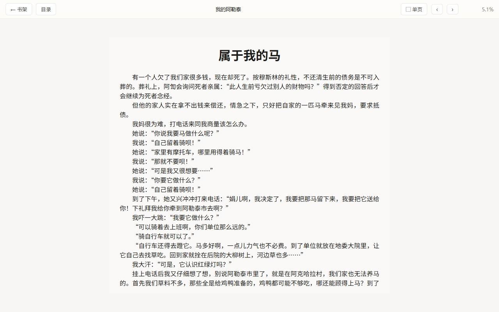
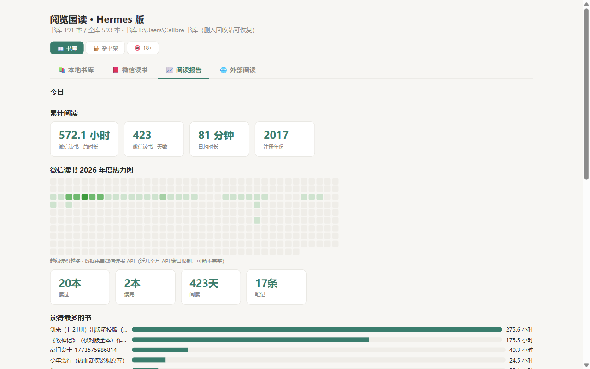
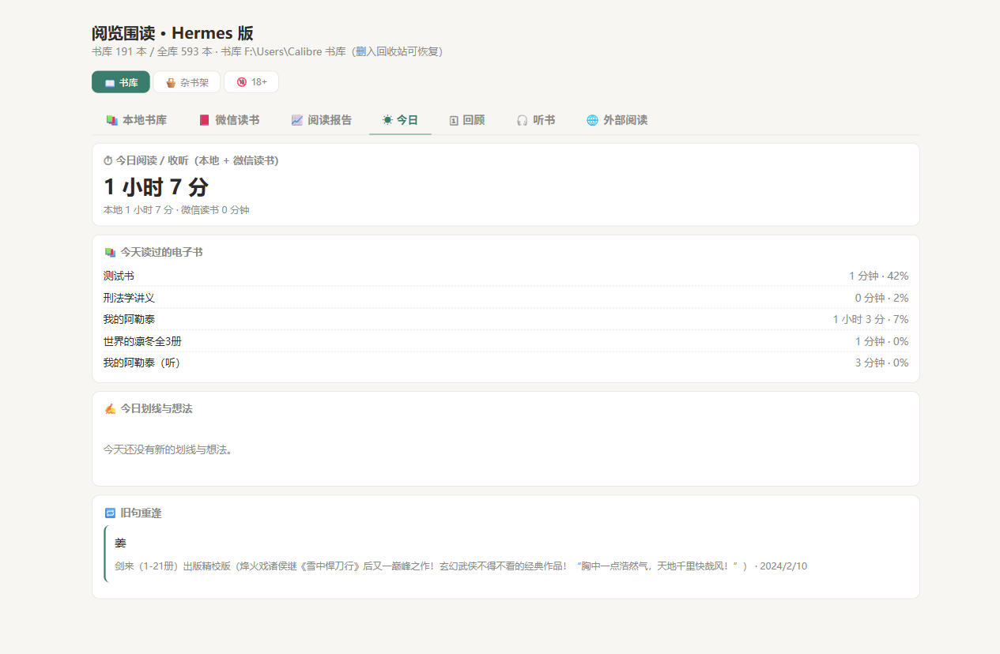
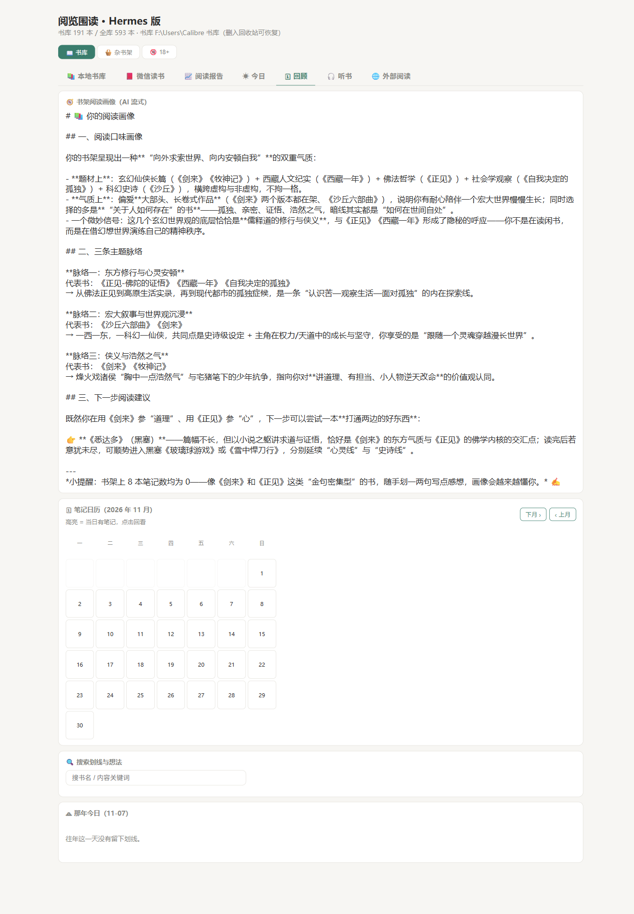

# 阅览围读 (yuelan-weidu) v1.2.0

把 Calibre 本地书库变成一个开箱即用的本地阅读器：Python 标准库 HTTP 服务 + foliate-js 在线阅读，配 Hermes 桌面插件侧栏入口。零第三方依赖（服务端）、无开机自启、只监听 `127.0.0.1:8766`。

> **v1.2.0 新增**：🎧 听书重构为播客 RSS 收听栏目（订阅/单集/内嵌播放器 + 断点续听 + 播放记录搜索）；书架管理模式批量移动/删减；手动上传本地图片做封面。

## 界面

| 本地书库 · 三分书架 | 阅读器 |
|---|---|
|  |  |

| 微信读书 · 在线书架 | 阅读报告 · 热力图 |
|---|---|
|  |  |

| ☀ 今日 | 🗓 回顾 |
|---|---|
|  |  |

| 🎧 听书 | |
|---|---|
|  | |

## 功能

- **本地书库**：扫描 Calibre 书库（epub/mobi/azw3/fb2/pdf/txt），三分书架（书库 / 杂书架 / 18+），重名去重，封面自动匹配（豆瓣 suggest）
- **阅读器**：foliate-js 引擎，淡雅米白主题，单页/双页切换，键盘（方向键/PageUp/空格）+ 鼠标滚轮翻页，章节目录
- **微信读书在线书库**（可选）：官方 Agent Gateway + API-Key，书架/阅读统计/AI 总结/划线笔记
- **☀ 今日**（v1.1.0）：今日阅读/收听总时长（本地 + 微信读书）、今天读过的电子书、当日划线与想法、旧句重逢（优先「那年今日」同月同日往年划线）
- **🗓 回顾**（v1.1.0）：笔记日历（月历高亮有笔记的日期，点击回看当日划线与想法）、那年今日、划线/想法关键词搜索与书名筛选
- **🎧 听书**（v1.1.0，v1.2.0 重构）：播客 RSS 收听栏目——预置 10 个中文播客源（半拿铁/知行小酒馆等，RSSHub 小宇宙源），可粘贴任意 RSS 订阅；单集列表 + 内嵌播放条（服务端音频代理支持拖进度）；**播放记录 + 断点续听**（每 5 秒/暂停/关页保存位置，下次「▶ 继续」直接跳到上次进度），记录可按节目/单集名搜索、一键清空；本地书系统 TTS 逐章连读保留（阅读页「▶ 朗读」入口）
- **书架管理**（v1.2.0）：管理模式下卡片多选，批量移入 书库/杂书架/18+ 或删除（进回收站）；手动书架调整按文件路径持久化，重新扫描不丢失
- **手动封面**（v1.2.0）：每本书可上传本地图片做封面（与豆瓣自动搜索互补，豆瓣无收录的书也能配图）
- **🤖 AI 总结**（v1.1.0）：SSE 流式输出——单本总结、划线主题分析、书架阅读画像；走 OpenAI 兼容网关（`ai.json` 配置 endpoint/model/key）
- **回收站**：删除先进 `_trash` 可恢复；彻底删除/清空需 confirm 口令双保险，磁盘文件同步删除
- **外部阅读**：一键用系统默认浏览器全窗口打开书库
- **阅读跟踪**：本地阅读/收听时长按天按书累计，进阅读报告热力图

## 运行

```bash
cd yuelan-weidu
py -3.14 -I -u server.py        # 或任意 Python 3.10+
# 打开 http://127.0.0.1:8766/
```

环境变量：

| 变量 | 默认 | 说明 |
|---|---|---|
| `QMU_LIB_ROOT` | `F:\Users\Calibre 书库` | Calibre 库根目录（其下含 `Calibre 书库\metadata.db`） |
| `QMU_SERVER_DIR` | 自动查找 | server.py 所在目录（Hermes 插件用） |

AI 流式总结（选配）：在本目录建 `ai.json`：
```json
{"endpoint": "http://127.0.0.1:3425/v1", "model": "auto/glm-5.3-flash", "apiKey": ""}
```

运行时在本目录生成：`books.json`（索引）、`shelf.json`（手动书架覆盖）、`listen.json`（播客播放记录）、`podcasts.json`（播客订阅）、`track.json`（阅读跟踪）、`weread.json`（微信读书 key，选配）、`ai.json`（AI 网关，选配）、`_trash/`（回收站）。均不入库（见 `.gitignore`）。

## Hermes 插件安装

- `hermes-plugin/desktop-plugin/plugin.js` → 复制到 `%LOCALAPPDATA%\hermes\desktop-plugins\yuelan-weidu\`（或 Hermes desktop plugins 目录），提供侧栏「阅览围读」入口 + 按需唤醒
- `hermes-plugin/backend-plugin/` → 复制到 Hermes `plugins/yuelan-weidu/`，提供 FastAPI `/status /start /stop`（按需 spawn server.py，20s 唤醒）
- 服务定位：环境变量 `QMU_SERVER_DIR`，或自动从插件文件向上查找含 `server.py` 的目录

## 结构

```
server.py                 # stdlib-only 书库服务（扫描/阅读/微信读书/回收站/跟踪/AI）
reader.html               # 单文件前端（书架 + 阅读器 + 报告）
foliate-js/               # foliate-js 引擎（vendored）
hermes-plugin/
  desktop-plugin/         # Hermes 桌面插件（侧栏入口 + iframe + 唤醒门）
  backend-plugin/         # Hermes 后端插件（FastAPI 唤醒 API）
```

## 致谢

- [foliate-js](https://github.com/johnfactotum/foliate-js)（MIT）——阅读引擎
- [qiaomu-reader](https://github.com/nick-chen-ze/qiaomu-reader)——本项目的前身（Obsidian 插件形态）

## License

MIT
